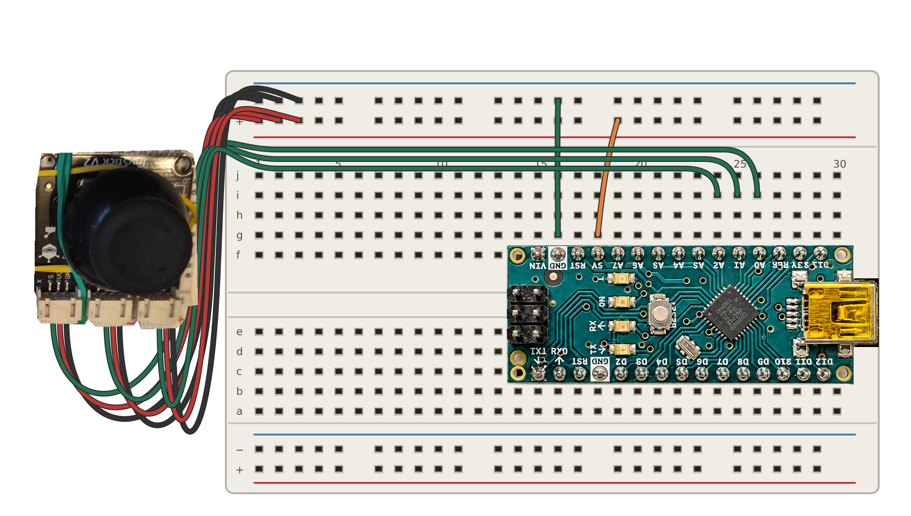

# Arduino joystick input

**Game:** [Snake](snake.html). The joystick sends direction commands to steer the snake.

Chromebook users: start with [Arduino setup](../setup.md). At **Wire and upload**, follow the wiring and upload instructions below, then return to the checklist for **Test serial output**.

**Hardware:** Arduino Nano, two-axis analog joystick, jumpers.

| Joystick pin | Arduino Nano |
| --- | --- |
| `VRx` | `A0` |
| `VRy` | `A1` |
| `VCC` | `5V` (if supported) |
| `GND` | `GND` |
| `SW` | Not connected |

Power off before wiring. Keep joystick centred when the Nano powers up or reconnects.

Upload [`joystick.ino`](joystick.ino).

**Test:** Push in each direction to see `UP`, `DOWN`, `LEFT`, and `RIGHT`. Return to centre before another command. Snake maps these commands to its steering controls.

## Play Snake

Close the Serial Monitor. On Chromebook, turn off Linux USB sharing before connecting.

1. Open [Snake](snake.html) in Chrome.
2. In the **Input** selector, choose **Joystick**.
3. Click **Connect Joystick** and select the Nano's serial port.
4. Play the game. Move the joystick to steer; return it to centre between turns.
