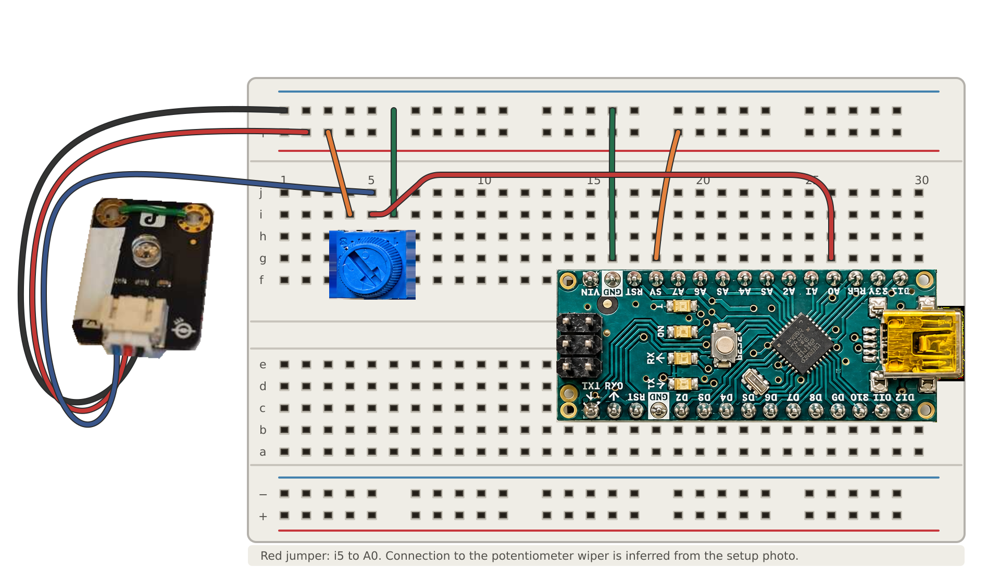

# Arduino analog input — light sensor

**Game:** [Flex Run](../../../flex-run.html).

This demo uses a light sensor as an example of an analog sensor. All analog sensors in these demos use a potentiometer for calibration.

Chromebook users: start with [Arduino setup](../../setup.md). At **Wire and upload**, follow the wiring and upload instructions below, then return to the checklist for **Test serial output**.

**Hardware:** Arduino Nano, light sensor, 10 kΩ calibration potentiometer, breadboard/jumpers.

Use the diagram for the sensor setup. The table lists the calibration potentiometer connections.

| Potentiometer pin | Arduino Nano |
| --- | --- |
| Outer pin 1 | `5V` |
| Middle (wiper) | `A0` |
| Outer pin 2 | `GND` |

Power off before wiring. Swapping the potentiometer's outer pins reverses the adjustment direction.

Upload [`analog.ino`](analog.ino).

**Test:** Vary the light reaching the sensor. Crossing above `TRIGGER` produces one `JUMP`; bring the reading below `RESET` to rearm. Adjust the calibration potentiometer or `TRIGGER`/`RESET` as needed (ADC range 0–1023).

## Play Flex Run

Close the Serial Monitor. On Chromebook, turn off Linux USB sharing before connecting.

Open [Flex Run](../../../flex-run.html), choose **Arduino sensors** and select **Connect Arduino**.

The first `JUMP` starts Flex Run; subsequent `JUMP` messages trigger jumps.
