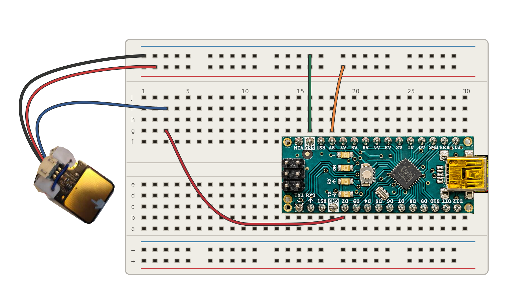

# Arduino digital input — magnetic sensor

**Game:** [Flex Run](../../../flex-run.html).

Chromebook users: start with [Arduino setup](../../setup.md). At **Wire and upload**, follow the wiring and upload instructions below, then return to the checklist for **Test serial output**.

**Hardware:** Arduino Nano, DFRobot Gravity Magnetic Sensor V2 (digital), magnet, jumpers.

| Sensor pin | Arduino Nano |
| --- | --- |
| `D` (signal) | `D2` |
| `+` (power) | `5V` (verify module rating) |
| `−` (ground) | `GND` |

Power off before wiring. Use pin markings rather than wire colours.

Upload [`digital.ino`](digital.ino).

**Test:** Bring the magnet close, then away. A `LOW → HIGH` transition produces one `JUMP`. If your module becomes `LOW` when the magnet approaches, change the condition to `state == LOW && previousState == HIGH`.

## Play Flex Run

Close the Serial Monitor. On Chromebook, turn off Linux USB sharing before connecting.

Open [Flex Run](../../../flex-run.html), choose **Arduino sensors** and select **Connect Arduino**.
