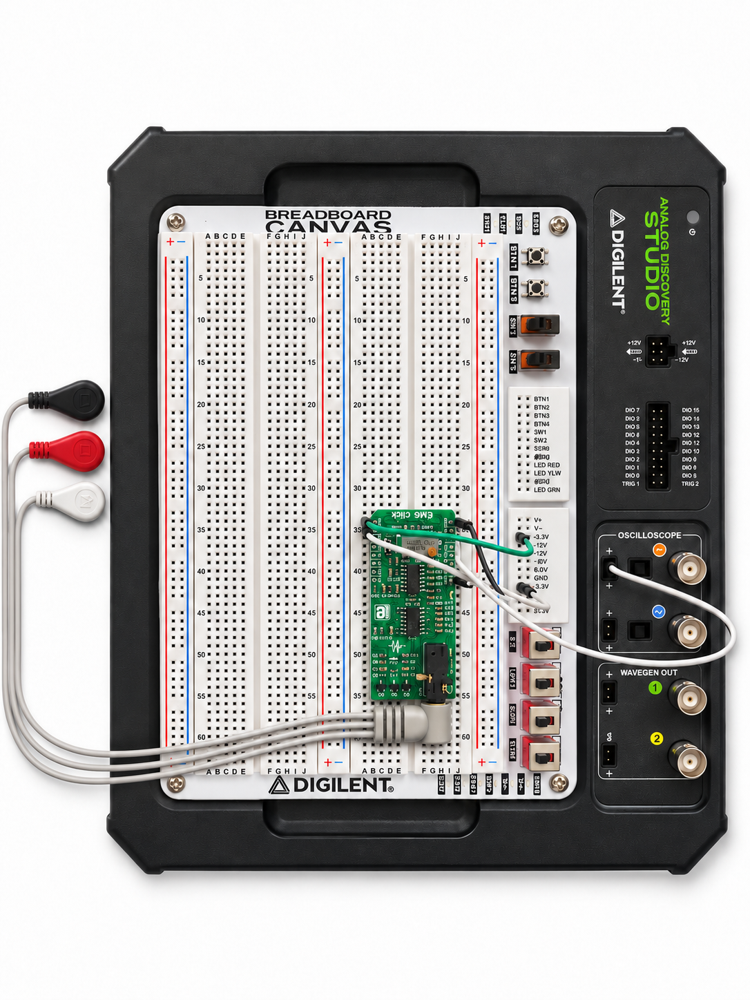
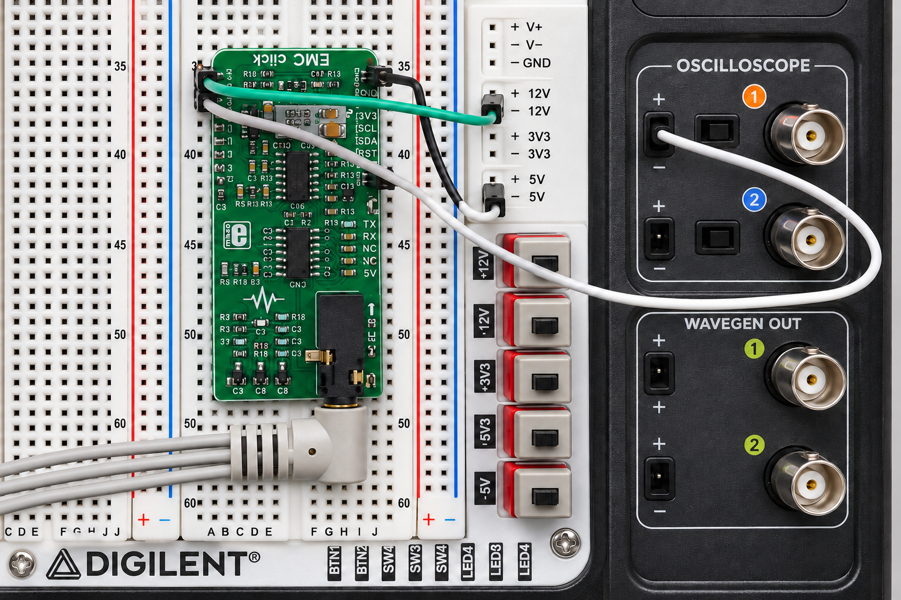

# Digilent EMG input

**Game:** [Flex Run](../../flex-run.html).

**Route:** Electrodes → EMG Click → Digilent Analog Discovery Studio **C1** → WaveForms SDK → Python → WebSocket `ws://127.0.0.1:8765` → [Flex Run](../../flex-run.html).

**Hardware/software:** EMG Click, suitable electrodes and interface/power, Digilent Analog Discovery Studio, USB connection, **macOS**, [WaveForms](https://digilent.com/reference/software/waveforms/waveforms-3/start), Python 3, Chrome.

**WaveForms workspace:** [EMG_Biceps.dwf3work](EMG_Biceps.dwf3work).






1. Wire the **amplified EMG output** to Digilent analog input **C1**, using the verified module/board connections. Connect Digilent by USB.
2. Install WaveForms. The script loads `/Library/Frameworks/dwf.framework/dwf`. If only the app-bundled SDK exists, install it with:

   ```bash
   sudo ditto /Applications/WaveForms.app/Contents/Frameworks/dwf.framework /Library/Frameworks/dwf.framework
   ```

3. Open a terminal in this `emg/` directory and install dependencies in a virtual environment:

   ```bash
   python3 -m venv .venv
   source .venv/bin/activate
   python -m pip install numpy scipy websockets
   ```

4. **Quit WaveForms** before running Python (the two cannot control the same device simultaneously). Run `python acquisition.py`.
5. Open [Flex Run](../../flex-run.html) **on the same Mac**, choose **Digilent EMG**, and click **Connect EMG**. The Python terminal should show the device and filtered voltage. A threshold crossing sends `JUMP`.

The demo uses **400 Hz acquisition**, three bandstop filters (**48–52, 98–102, 148–152 Hz**), trigger **1.4 V**, rearm **1.3 V**, and cooldown **0.4 s**. The threshold value (`THRESHOLD` in [`acquisition.py`](acquisition.py)) can be adjusted as needed.

**Check:** Python prints `EMG server listening on port 8765` before the browser connects, and then filtered voltages. If it detects no devices, check USB, SDK installation and that WaveForms is closed. A browser connection by itself does not prove that the EMG signal is valid.
